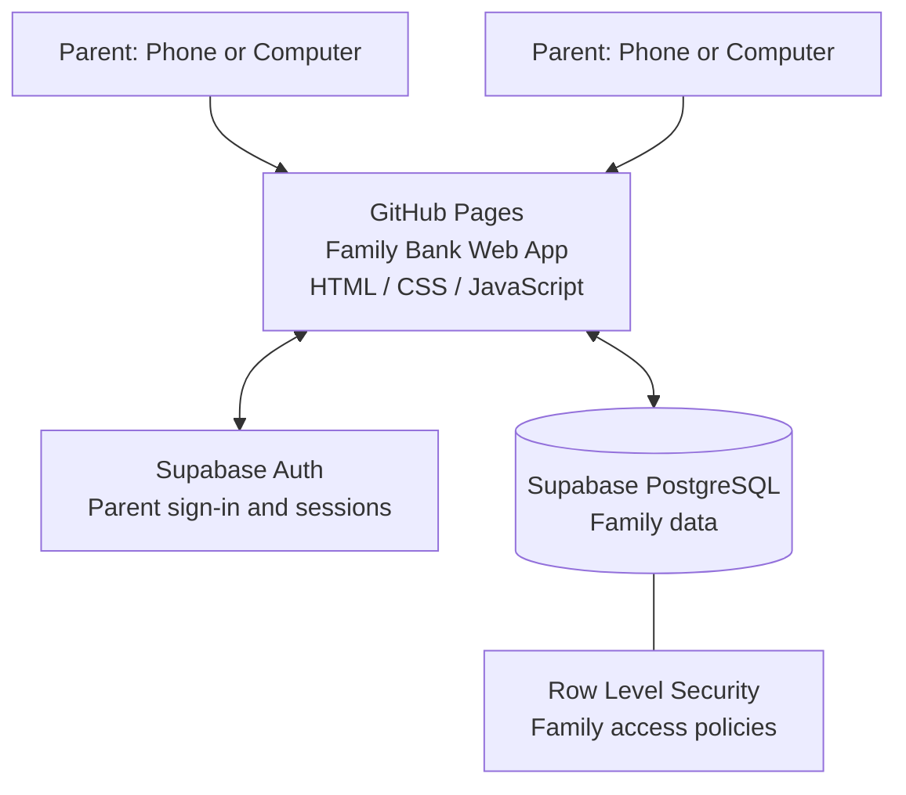
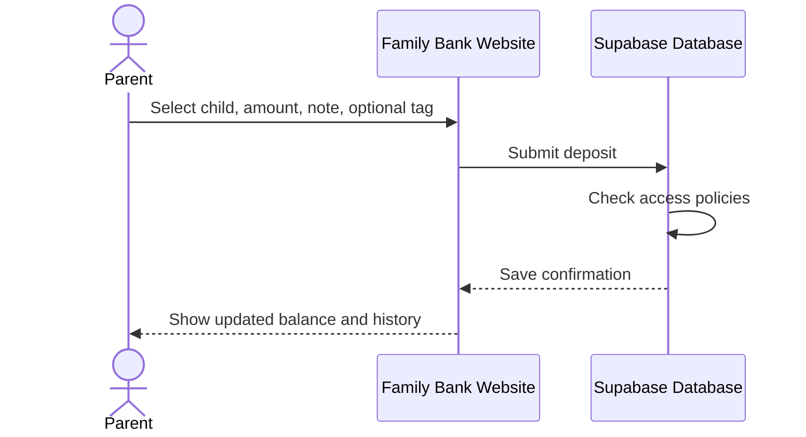
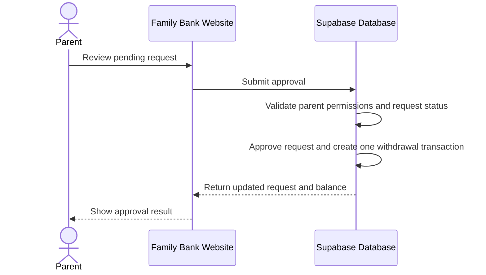

# Family Bank Idea

> **Status (Oct 10, 2026):** Original design, partly superseded. The live `children` table uses `name` (no `is_active`), interest is now computed client-side, and the main screen is a child picker. See `04 AI/Allowances/allowances_ai_brief.md` for current state.

## 1. Purpose

A small, private family web app for tracking children's deposits, balances, encouraging notes, achievements, and withdrawal requests.

- **Users:** Two parents with separate accounts, managing profiles for Athena and Felix.
- **Frontend hosting:** GitHub Pages
- **Backend and database:** Supabase
- **MVP principle:** Keep the financial record simple and auditable. Not every positive moment needs to earn money.

## 2. System Architecture



### Component responsibilities

- **GitHub Pages:** Hosts the website and user interface.
- **Supabase Auth:** Handles parent sign-in and persistent sessions.
- **Supabase PostgreSQL:** Stores family profiles, transactions, notes, and requests.
- **Row Level Security (RLS):** Enforces database permissions so only authorized family members can access the records.

The website URL may be publicly reachable, but family data must remain protected by authentication and database policies.

## 3. Main User Interface

```text
┌──────────────────────────────────────────┐
│ FAMILY BANK                     Parent   │
├──────────────────────────────────────────┤
│ ATHENA'S BALANCE       FELIX'S BALANCE   │
│      $24.50                 $18.00       │
├──────────────────────────────────────────┤
│ [+ Record a moment]                      │
├──────────────────────────────────────────┤
│ RECENT TRANSACTIONS                      │
│                                          │
│ Running club                    +$2.00   │
│ "I loved seeing your determination."     │
│                                          │
│ Reading together                +$1.00   │
│ "A little reading every day adds up."    │
├──────────────────────────────────────────┤
│ WITHDRAWAL REQUESTS                      │
│ Save toward a toy — Athena — $8.00       │
│ [Review requests]     [Full history]     │
└──────────────────────────────────────────┘
```

*Balances and transactions are illustrative sample data, not live account data.*

## 4. Database Schema

Start with four tables.

### `parents`

Stores parent identities and family membership.

- `id` — primary key associated with the authenticated user
- `family_id` — identifies the family
- `display_name`
- `created_at`

### `children`

Stores each child's profile.

- `id` — primary key
- `family_id` — family that owns the profile
- `display_name`
- `created_at`
- `is_active`

### `transactions`

The authoritative financial ledger.

- `id` — primary key
- `family_id`
- `child_id`
- `created_by` — parent who recorded the transaction
- `type` — `deposit`, `withdrawal`, `interest`, or `adjustment`
- `amount` — positive monetary amount; the transaction type determines its effect on the balance
- `note` — explanation or love note
- `achievement_tag` — optional activity or achievement label
- `occurred_at` — date the event happened
- `created_at`

**Balance rule:** Calculate a child's balance from the transaction ledger. Deposits and interest add to the balance; withdrawals subtract from it. Record corrections as traceable adjustments rather than silently editing old entries.

### `withdrawal_requests`

Stores requests before they become financial transactions.

- `id` — primary key
- `family_id`
- `child_id`
- `requested_amount`
- `purpose`
- `status` — `pending`, `approved`, or `declined`
- `reviewed_by` — parent who reviewed the request
- `reviewed_at`
- `created_at`

**Approval rule:** A pending request does not change the balance. Approval must create exactly one withdrawal transaction, even if the parent clicks more than once.

## 5. Core Workflows

### Record a deposit



### Approve a withdrawal



The approval and transaction creation should be handled atomically in the database, such as through a database function or transaction, to prevent duplicate withdrawals.

## 6. Security and Configuration

- Require each parent to sign in with Supabase Auth.
- Enable Row Level Security on every table containing family data.
- Check family membership for reads and writes; do not rely only on hiding screens in the frontend.
- Keep the Supabase **service-role key** and other administrative secrets out of browser code and the public GitHub repository.
- The Supabase project URL and public/publishable key can be used in the frontend when database policies are correctly configured.
- Test that unauthenticated users and users outside the family cannot read or change family records.
- Use HTTPS and keep dependencies reasonably current.

## 7. Implementation Plan

1. Create a Supabase project.
2. Configure parent authentication.
3. Create the four tables, relationships, and constraints.
4. Enable and test Row Level Security policies.
5. Build the responsive website: dashboard, deposit form, transaction history, and withdrawal review.
6. Connect the frontend to Supabase using the project URL and public/publishable key.
7. Publish the static site with GitHub Pages.
8. Test on both parents' devices, including concurrent use, permissions, and duplicate withdrawal approval.

## 8. MVP Scope

### Include first

- Parent sign-in
- Athena and Felix profiles
- Record deposits with a note and optional tag
- Transaction history
- Automatically calculated balances
- Withdrawal requests and parent approval

### Consider later

- Interest bonuses
- Weekly summaries or animations
- More detailed achievement categories
- Child-facing read-only dashboard
- Export and restore workflows

## 9. Official References

- [Supabase — Getting Started](https://supabase.com/docs/guides/getting-started)
- [Supabase — Authentication](https://supabase.com/docs/guides/auth)
- [Supabase — Row Level Security](https://supabase.com/docs/guides/database/postgres/row-level-security)
- [GitHub Pages](https://docs.github.com/en/pages)

---

**Architecture summary:** GitHub Pages serves the Family Bank interface; Supabase handles parent authentication, persistent storage, and database-enforced permissions. The transaction ledger is the source of truth for balances.